<p align="center">
  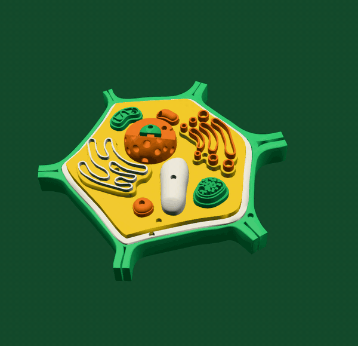
</p>

<h1 align="center">WRA STEM Kits</h1>

<p align="center">
  <b>A 3D printed plant cell that middle school students can take apart, plus the web tools their teachers need to teach with it.</b>
</p>

<p align="center">
  <a href="https://wrastem.com"></a>
  
  
  
</p>

<p align="center">
  <a href="https://wrastem.com"><b>Website</b></a> ·
  <a href="https://wrastem.com/standards-ai/"><b>Standards AI</b></a> ·
  <a href="https://wrastem.com/cell-kit-generator/"><b>Worksheet Generator</b></a> ·
  <a href="https://wrastem.com/purchase/"><b>Request kits</b></a>
</p>

<p align="center"><i>A student Compass project at Western Reserve Academy</i></p>

---

## What it is

WRA STEM Kits makes hands-on science kits for middle school classrooms. The first kit is a **plant cell model made of 12 custom-designed, 3D printed pieces**. Students lift each organelle out of its custom-shaped slot, name it, explain its job, and set it back. Magnets hold the pieces in their slots, and nothing gets used up, so one kit serves class after class.

This website introduces the kit and the tools that come with it. A teacher can explore the kit in 3D, print a worksheet and answer key, ask questions about the science standards, and request kits for their class.

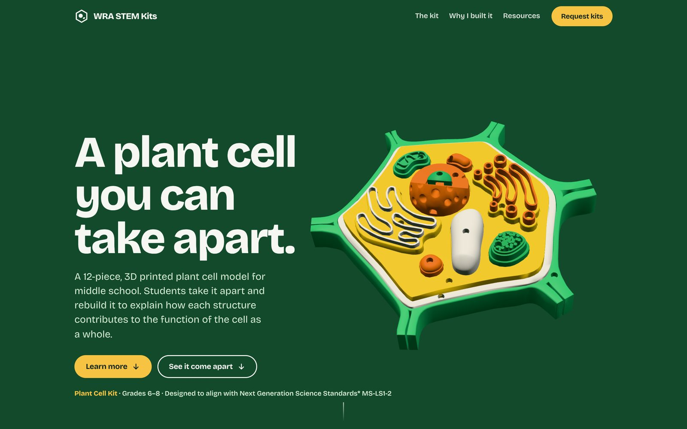

## The kit

<table>
  <tr>
    <td width="50%">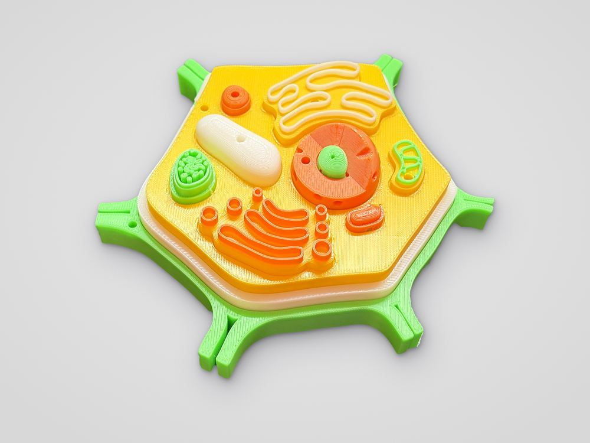</td>
    <td width="50%">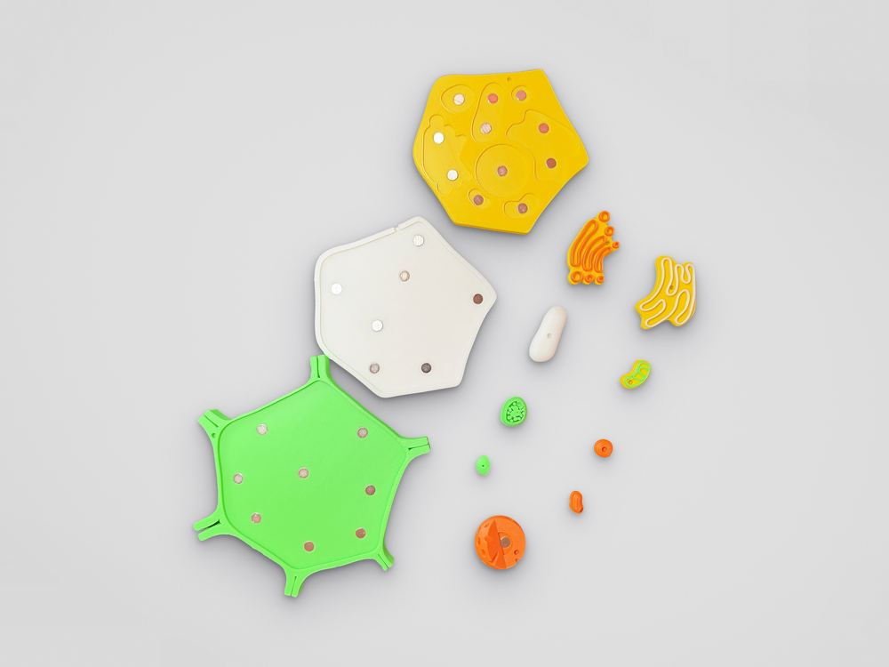</td>
  </tr>
  <tr>
    <td align="center"><sub>The printed kit, assembled</sub></td>
    <td align="center"><sub>Every piece laid out</sub></td>
  </tr>
</table>

| | |
|---|---|
| **12 pieces** | Cell wall, cell membrane, cytoplasm tray, nucleus, nucleolus, chloroplast, mitochondrion, Golgi apparatus, endoplasmic reticulum, central vacuole, peroxisome and amyloplast |
| **Magnets** | Magnets hold the pieces in their slots. The small holes are for labels. |
| **Grades** | Middle school life science, grades 6–8 |
| **Standard** | Designed to align with NGSS MS-LS1-2: *"Develop and use a model to describe the function of a cell as a whole and ways the parts of cells contribute to the function."* The five parts the standard names (nucleus, chloroplast, mitochondrion, cell membrane, cell wall) use the same names in the kit. |
| **Reusable** | Nothing gets used up, so one kit lasts for years of classes. |

On the website, the kit comes apart as you scroll, and every part is labeled. Further down, teachers can turn the model, take it apart, and tap any part to read what it does.

<table>
  <tr>
    <td width="50%">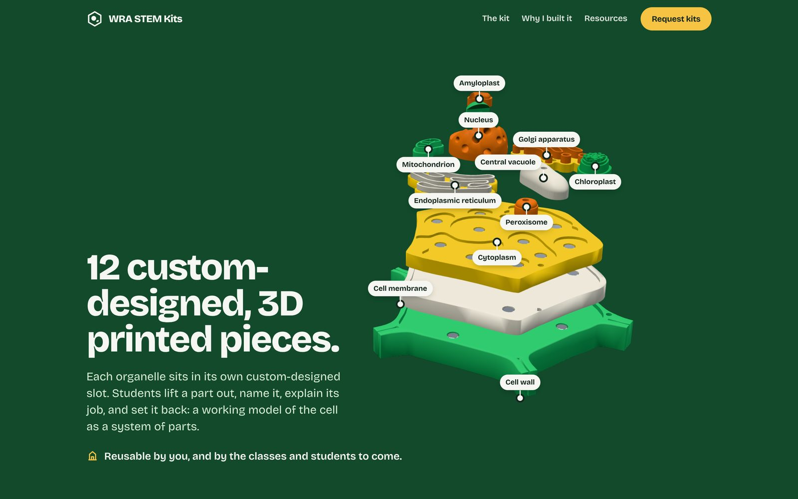</td>
    <td width="50%">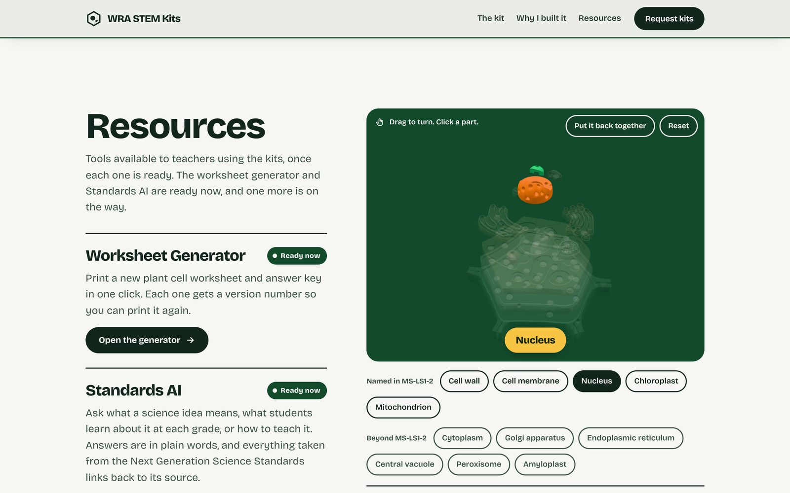</td>
  </tr>
  <tr>
    <td align="center"><sub>Scroll and the cell comes apart, with every part labeled</sub></td>
    <td align="center"><sub>Tap a part to see it on its own and read what it does</sub></td>
  </tr>
</table>

## Tools for teachers

### Standards AI
A teaching assistant for science teachers that talks like a helpful colleague. It answers first in plain words, then gives the facts and an everyday comparison. If something doesn't click, just say "I don't get it" and it explains it another way. It also helps teachers explain an idea to students, and plans lessons and activities, asking about the class first. Its science comes from a set of checked science notes; anything it says about the Next Generation Science Standards\* is checked against the standard's text, and **Find it in the NGSS** under each answer opens the exact spot in the standard with the topic highlighted.

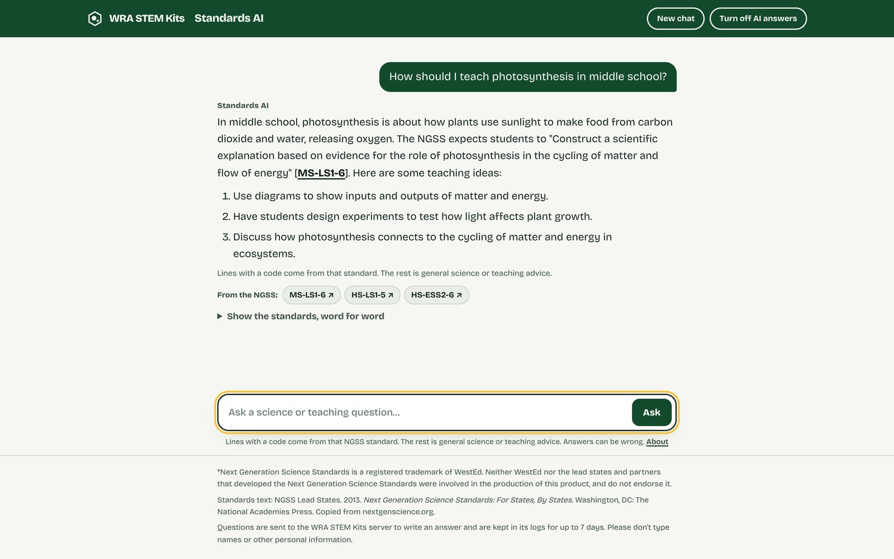

### Worksheet Generator
One click prints a new 3-page plant cell worksheet and its answer key.
- **Fixed question bank:** every question comes from a bank of 69 that a teacher can review, rather than being generated on the spot.
- **Same six sections each time:** labeling, matching, how the parts work together, two short written answers, and multiple choice.
- **Drawings from the kit:** the labeling drawings are rendered from the kit's own 3D model.
- **Version numbers:** each worksheet has a number (1000–9999) that rebuilds exactly the same sheet later.
- **PDF or print, even offline:** it downloads as a PDF or prints from the browser, and works without internet once the page has loaded.

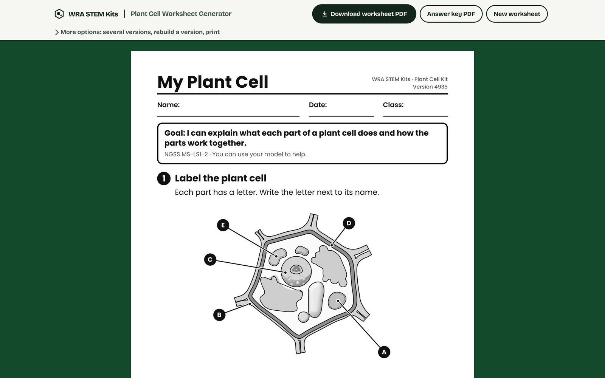

### Request kits
A short form (number of sets, school, email). Each request is emailed straight to the kit maker, who replies to the teacher. A photo of the real kit opens a gallery of eight photos that visitors can swipe through.

<table>
  <tr>
    <td width="50%">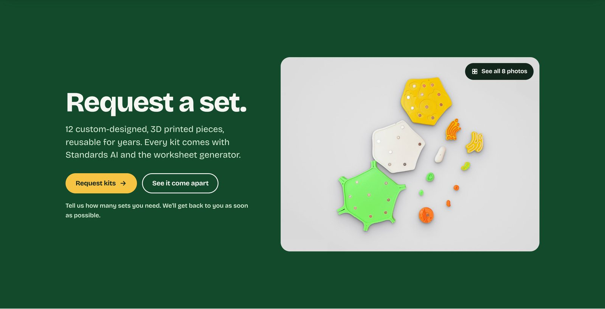</td>
    <td width="50%">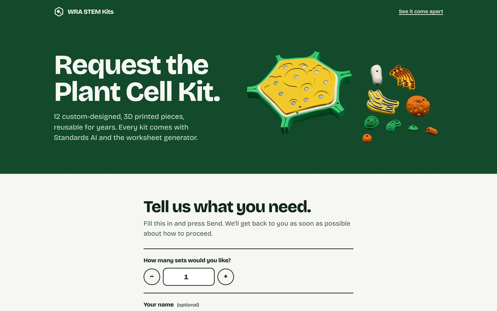</td>
  </tr>
  <tr>
    <td colspan="2">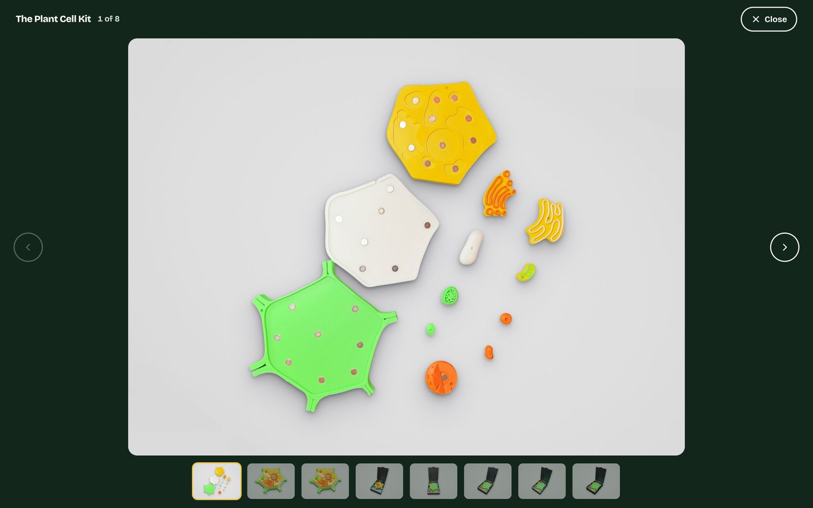</td>
  </tr>
</table>

## On a phone

The whole site works on phones. The words sit at the bottom of the screen and the model fills all the room above them.

<table>
  <tr>
    <td width="33%">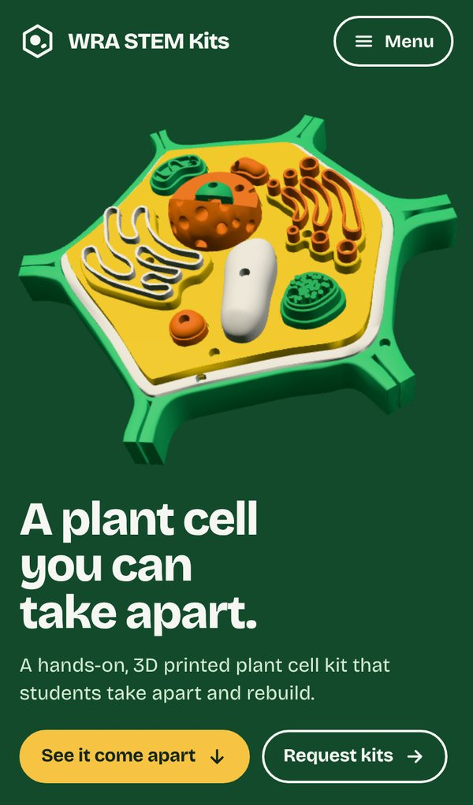</td>
    <td width="33%">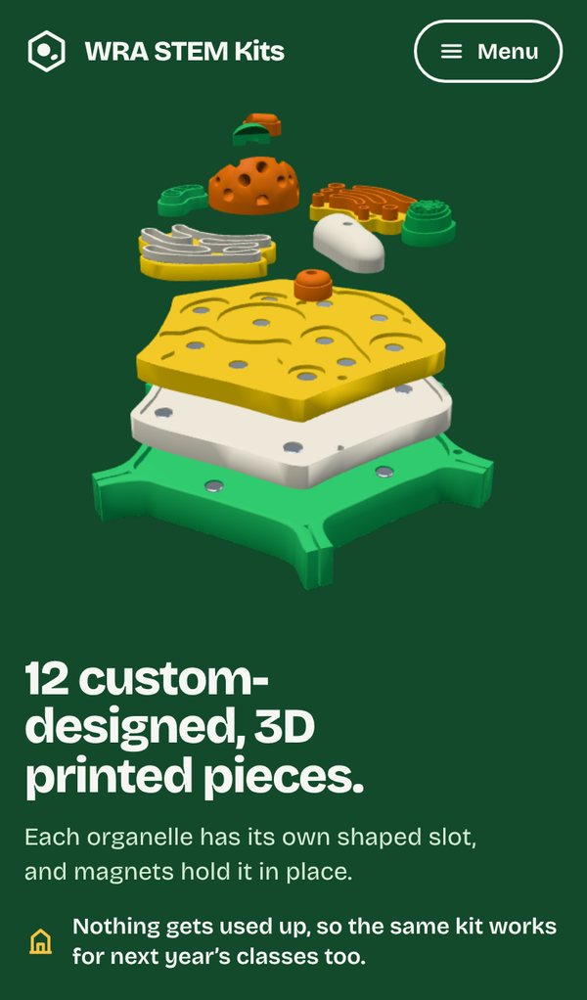</td>
    <td width="33%">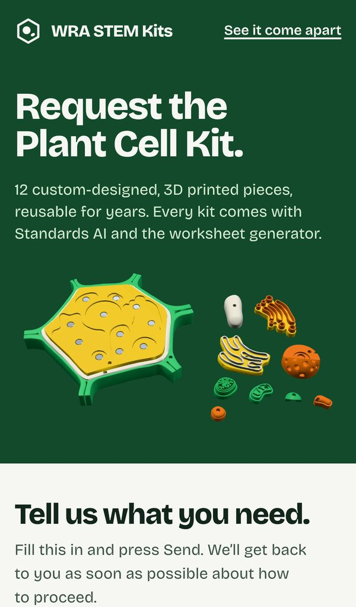</td>
  </tr>
</table>

## How it's built

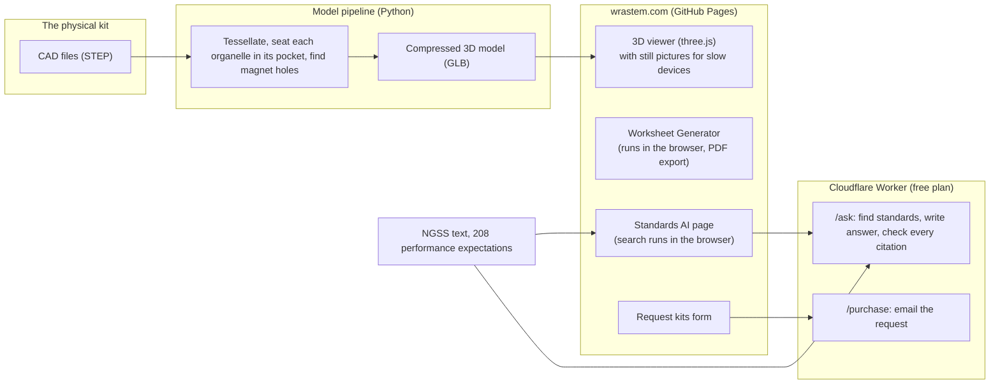

- **3D model.** The kit's CAD files are turned into one small web model by scripts in [`src/model-pipeline/`](src/model-pipeline).
  - Each organelle is seated in its pocket in the cytoplasm tray automatically.
  - Every magnet hole gets its magnet.
  - Each part is painted its real print colour.
  - The viewer ([`src/cell-viewer.js`](src/cell-viewer.js)) draws only while something moves. Slower devices automatically get still pictures rendered from the same model instead.
- **Standards AI.**
  - **Search in the browser:** the page searches the full text of all 208 NGSS performance expectations. It understands misspelled and even scrambled words, and works without the AI.
  - **Written answers:** the [Cloudflare Worker](worker) has a language model write a short answer from the matching standards.
  - **Checks before an answer goes out:** every quote must match the standard word for word, every code must point at a standard it was given, and grade levels are corrected.
  - **Standards text:** collected from nextgenscience.org by [`src/ngss-pipeline/`](src/ngss-pipeline).
- **Worksheet Generator.** A single self-contained page that works offline. PDFs are made in the browser. Its PDF tools are stored in the page as plain text and only start when a PDF is wanted (or once the computer is idle), so the worksheet appears first on slow laptops.
- **Fast on slow networks and old computers.**
  - **Offline copy:** [`sw.js`](sw.js) (a service worker) keeps the pages and files you have opened on the device. Pages always try the network first, but if it hasn't answered in 3 seconds the saved copy shows instead, and with no network at all the site still opens.
  - **Next page early:** pointing at (or pressing) a link to another page starts loading it, so it opens almost at once. Browsers under Data Saver skip this.
  - **3D only when it will be quick:** the live model is skipped on slow connections, Data Saver, low memory and software-only graphics; those devices get still pictures of the same model.
  - **Right-sized photos:** the photo viewer downloads a 1000-pixel photo on laptop and Chromebook screens and the full 1600-pixel one only on large screens.
  - **Installable:** [`manifest.webmanifest`](manifest.webmanifest) lets a teacher add the site to a Chromebook or phone home screen.
- **Request kits.** The same Worker emails each request through Cloudflare's email service. A hidden field and a rate limit keep spam out. Each email also shows the sender's IP address, its rough location, and whether the email address looks like a school's, so a fake request is easy to spot.
- **Hosting.** The site runs on GitHub Pages and the server on Cloudflare's free plans, so the tools cost nothing to run.

## Security

The site has no accounts, passwords or database, so there is nothing to log in to and no stored data to steal. What it does have is protected like this:

- **No secrets in the code.** The only secret (the inbox that kit requests go to) is saved in Cloudflare, not in this repository. There are no API keys: the AI runs inside Cloudflare.
- **Only wrastem.com may use the server.** The Worker refuses questions and kit requests that don't come from the site's own pages, limits how many one visitor can send a minute, refuses oversized or malformed requests, and never shows a visitor the inside of an error.
- **Nothing a visitor or the AI writes can run as code.** The pages show it as plain text, and each page carries a Content Security Policy (the `Content-Security-Policy` line near the top of each HTML file) that tells the browser what the page may load and where it may send data.
- **Checked by tests.** `npm test` in [`worker/`](worker) runs the server's protections against attacks.

**If you add something from another website** (a video, a font, an analytics script), the browser will block it until that site's address is added to the `Content-Security-Policy` line of the page that uses it. On the Standards AI, Request kits, Privacy Policy and page-not-found pages, scripts must be in their own `.js` files: a `<script>` written into those pages will not run.

## Repository map

| Path | What it is |
|---|---|
| [`index.html`](index.html) | Home page: the kit coming apart as you scroll, the 3D viewer (Take a closer look), the teacher tools, why it was built and the kit at a glance, Request kits |
| [`standards-ai/`](standards-ai) | Standards AI chat page (`index.html`), its script (`app.js`), its search code and the NGSS data |
| [`cell-kit-generator/`](cell-kit-generator) | Worksheet and answer key generator |
| [`purchase/`](purchase) | Request kits form (its script is [`assets/js/purchase.js`](assets/js/purchase.js)) |
| [`privacy/`](privacy) | Privacy Policy. The request form can't be sent until its "I agree" box is ticked |
| [`accessibility/`](accessibility) | Accessibility Statement: the WCAG 2.1 AA goal, known gaps (image-only PDFs, 3D model) and how to report a problem |
| [`404.html`](404.html) | The "page not found" page (its script is [`assets/js/not-found.js`](assets/js/not-found.js)). GitHub Pages shows it for any address that doesn't exist, so its links and files all start with `/` |
| [`worker/`](worker) | Cloudflare Worker for Standards AI answers and purchase requests ([setup notes](worker/README.md)) |
| [`src/`](src) | Source for the 3D viewer, the model pipeline, the NGSS pipeline and the photo rotation script ([build notes](src/README.md)) |
| [`assets/`](assets) | Fonts, images, the 3D model and the built viewer. The header, footer, buttons and motion every page shares are in [`assets/css/site.css`](assets/css/site.css) and [`assets/js/site.js`](assets/js/site.js) (the worksheet generator keeps its own copy so it works offline). Logo files are in [`assets/brand/`](assets/brand) |
| [`DESIGN.md`](DESIGN.md) | The design system |
| [`sw.js`](sw.js), [`manifest.webmanifest`](manifest.webmanifest) | The offline copy (service worker) and the install details for the whole site |
| [`.claude/skills/modern-web-guidance/`](.claude/skills/modern-web-guidance) | Modern Web Guidance, a Claude Code skill from the Chrome, Edge, Firefox and MDN teams: 210 guides on current HTML, CSS and JavaScript practice, kept here so any Claude Code session in this repository can use it (type `/modern-web-guidance`) |
| [`sitemap.xml`](sitemap.xml), [`robots.txt`](robots.txt) | The list of pages and pictures for search engines, and which folders they should skip |
| `favicon.ico`, `favicon-96x96.png`, `favicon.svg`, `apple-touch-icon.png` | The site icon in the sizes browsers, phones and search results ask for |
| `9113d54f23e68ee25a1596c5112c4986.txt` | Public IndexNow verification file, so search engines accept page updates from wrastem.com (not a secret) |

## How the site shows up in search

Each page tells search engines what it is in its `<head>`: a title, a description, the site icon, the share picture, and a short block of facts (`application/ld+json`) with the site name, the page's place on the site and, on the home page, a real photo of the printed kit.

- **Site icon in Google.** Google reads the icon from the home page only, and can take days to weeks to show a new one. Until then it shows a grey globe.
- **Site name.** "WRA STEM Kits" comes from the facts block on the home page. Google shows the bare address until it has read it.
- **Picture next to a result.** Google chooses this itself. The home page allows a large picture (`max-image-preview:large`) and points to the kit photo in `assets/img/photos/` (4:3 and a square crop).
- **After changing a page,** update its date in `sitemap.xml`. To ask Google to re-read a page sooner, open [Google Search Console](https://search.google.com/search-console), paste the page's address into the bar at the top and choose "Request indexing".

## Run it locally

The website is plain HTML, CSS and JavaScript, so no build step is needed:

```bash
python3 -m http.server 8000
```

Then open http://localhost:8000. The server for Standards AI and the request form lives in `worker/`. See [worker/README.md](worker/README.md) to deploy your own.

The live server only answers pages on wrastem.com, so on your own computer the Standards AI page shows the matching standards without a written answer, and the request form can't send. [worker/README.md](worker/README.md#who-can-use-the-server) explains how to allow a local address.

## Status

Built and working: the 3D printed kit, the website, the worksheet generator, Standards AI and the request form are all live. The kit has **not yet been tried in a classroom**, and a science teacher review of the worksheet questions is planned. The kit is designed to align with the NGSS.

## Why I built it

> I built WRA STEM Kits because I want to help students learn science by holding it in their hands, not just reading about it in a textbook. I designed the kit to be affordable and reusable, so that as many teachers and students as possible, anywhere in the world, can use it in their classrooms.
>
> — Mark, Western Reserve Academy

## Credits

- **Kit design, 3D modeling and printing, and product direction:** Mark, a student at Western Reserve Academy, as a Compass project.
- **Built with:** [Claude Code](https://claude.com/claude-code) (Anthropic's AI coding assistant), which wrote much of the website and tool code under Mark's direction.
- **Libraries:** [three.js](https://threejs.org) and the meshoptimizer decoder (MIT) for the 3D viewer; [jsPDF](https://github.com/parallax/jsPDF) and [html2canvas](https://html2canvas.hertzen.com) (MIT) for worksheet PDFs.
- **Fonts:** [Bricolage Grotesque](https://github.com/ateliertriay/bricolage) and [Poppins](https://github.com/itfoundry/Poppins), both under the SIL Open Font License 1.1 (license text in [`assets/fonts/`](assets/fonts)).
- **AI:** Standards AI answers are written by Meta's Llama models running on Cloudflare Workers AI. Built with Llama.
- **Standards text:** NGSS Lead States. 2013. *Next Generation Science Standards: For States, By States.* Washington, DC: The National Academies Press.

<sub>\*Next Generation Science Standards is a registered trademark of WestEd. Neither WestEd nor the lead states and partners that developed the Next Generation Science Standards were involved in the production of this product, and do not endorse it.</sub>
